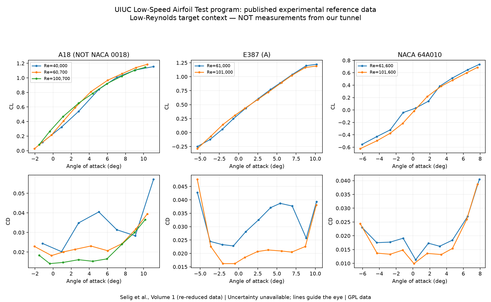

# Low-Reynolds-number experimental reference results

**Published UIUC data, not measurements from our tunnel.** Updated 2026-11-23.
These data were produced under the UIUC Low-Speed Airfoil Test program.

Selig, Guglielmo, Broeren and Giguere, *Summary of Low-Speed Airfoil Data*, Volume 1 (1995), re-reduced release Q01.00D. [Source, license and book links](https://m-selig.ae.illinois.edu/pd.html). Original source files, GPL license, notices and manifesto are retained in [data/reference/uiuc](data/reference/uiuc). Derived data and figures are GPL v2; see that directory's NOTICE.md. No endorsement is implied.

## Reproduce

```sh
python -m pip install -e ".[plot,test]"
python scripts/low_reynolds.py
python -m pytest -q
# Optional source re-download with hash checks:
python scripts/fetch_uiuc.py
```

The analysis selects seven clean-condition runs for three airfoils within Re=30,000–110,000, totaling 67 points. Each run's actual average Re and original run ID are retained. No smoothing, digitization or extrapolation is used. Source lift files are preserved but not analyzed: their header explicitly warns that the moment column is meaningless. No pitching-moment results are reported.

## Sampled performance

| Airfoil | Average Re | Points | Lowest sampled CD | Highest sampled CL/CD |
|---|---:|---:|---:|---:|
| A18 | 40,000 | 7 | 0.0202 | 39.15 |
| A18 | 60,700 | 9 | 0.0182 | 46.71 |
| A18 | 100,700 | 9 | 0.0141 | 55.76 |
| E387 (A) | 61,000 | 11 | 0.0228 | 46.61 |
| E387 (A) | 101,000 | 11 | 0.0162 | 51.55 |
| NACA 64A010 | 61,600 | 10 | 0.0113 | 27.99 |
| NACA 64A010 | 101,600 | 10 | 0.0099 | 31.10 |

These are extrema among the supplied samples, not optimized performance or stall estimates. Angle grids differ, so extrema are not matched-AoA comparisons. A18 is a distinct airfoil, **not NACA 0018**. No reference shown here validates the NACA 0018 demo.

## Reynolds sensitivity, with mismatches retained

For each airfoil, compare the lowest to highest selected Re. Use low-Re samples between -2° and +8°, pair to the nearest high-Re AoA only within 0.25°, and do not interpolate. Every pair is marked `reynolds_mismatch`. This measures observed reference differences at approximately equal AoA, not AeroLab prediction error; angle offsets also contribute.

| Airfoil | Re comparison | Pairs | CL RMSE | CD RMSE |
|---|---|---:|---:|---:|
| A18 | 40,000 vs 100,700 | 2 | 0.12943 | 0.013851 |
| E387 (A) | 61,000 vs 101,000 | 5 | 0.02966 | 0.013324 |
| NACA 64A010 | 61,600 vs 101,600 | 7 | 0.07934 | 0.002843 |

The small pair counts limit interpretation. The data show why Reynolds matching matters; they do not isolate Reynolds effects from all experimental differences.

## Data-reduction and uncertainty checks

Recomputing each published mean CD from its spanwise CD values gives a maximum absolute discrepancy of **0.000075**, below the **0.0001** combined rounding bound for quantities displayed to four decimals. This checks parsing and an independently reproducible averaging operation on real data. It does not verify the original force or wake-pressure reduction, nor calibrate AeroLab hardware.

Spanwise sample standard deviation is exported as a spatial-variation diagnostic; it is **not** standard measurement uncertainty and is not divided by sqrt(n) to invent error bars. The distributed tables do not supply complete pointwise uncertainty budgets, so combined uncertainties and statistical agreement claims remain unavailable. No 95% intervals are fabricated.



Machine-readable rows, metrics, source hashes and design setpoints are in [validation/low_reynolds](validation/low_reynolds). See [WIND_TUNNEL_GOALS.md](WIND_TUNNEL_GOALS.md) for the intended range and conditions required to demonstrate it experimentally. The Re=6-million NASA example remains a historical software reference, not the tunnel's intended operating target.
